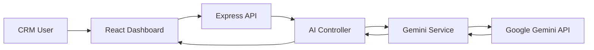
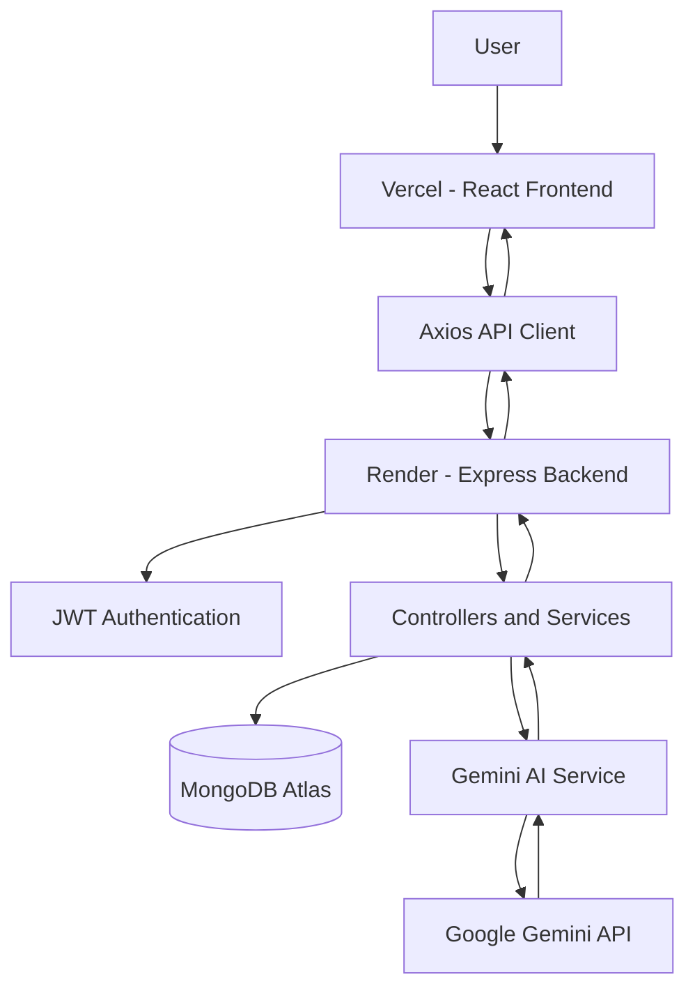

# ClarioCRM

<p align="center">
  
</p>

<p align="center">
  <strong>Turn customer relationships into meaningful business growth.</strong>
  <br />
  An AI-powered CRM dashboard for managing leads, customers, sales workflows and business insights.
</p>

<p align="center">
  <a href="YOUR_VERCEL_URL">LIVE APPLICATION ↗</a>
  &nbsp;·&nbsp;
  <a href="https://github.com/chanu2005-wq/AI_CRM_DASHBOARD">SOURCE CODE</a>
</p>

<p align="center">
  
  
  
  
  
  
</p>

---

## Product in Action

<p align="center">
  
</p>

<p align="center">
  <sub>Application walkthrough · Dashboard · Lead management · AI-powered workflows</sub>
</p>

> Replace the demo GIF with an actual recording of the deployed application. If you haven't created it yet, the screenshot gallery below can serve as the initial product showcase.

<p align="center">
  
  
</p>
<p align="center">
  
  
</p>

---

<details open>
<summary><strong>📚 Explore Documentation</strong></summary>

- [01 — Introduction](#-introduction)
- [02 — Features](#-features)
- [03 — AI Capabilities](#-ai-capabilities)
- [04 — Technology Stack](#-technology-stack)
- [05 — Architecture](#-architecture)
- [06 — Project Structure](#-project-structure)
- [07 — Installation](#-getting-started)
- [08 — Environment Configuration](#-environment-configuration)
- [09 — Demo Account](#-demo-account)
- [10 — API Reference](#-api-reference)
- [11 — Deployment](#-deployment)
- [12 — Security](#-security)
- [13 — GitHub Activity](#-github-activity)
- [14 — Future Improvements](#-future-improvements)
- [15 — Author](#-author)

</details>

---

## Introduction

**ClarioCRM** is a full-stack Customer Relationship Management application that brings customer management, sales tracking and AI-assisted workflows into one centralized dashboard.

Traditional CRM workflows often involve switching between multiple tools to manage customer details, sales opportunities, follow-ups and communication.

ClarioCRM provides a unified workspace to organize these activities while using Google Gemini AI to assist with repetitive CRM tasks.

### What ClarioCRM brings together

| Customer Management | Sales Operations | AI Assistance |
|:---:|:---:|:---:|
| Leads and contacts | Pipeline tracking | Lead summaries |
| Customer notes | Tasks and follow-ups | Email generation |
| Customer records | Dashboard analytics | Sales insights |

---

## Features

### A workspace for everyday CRM operations

| Module | Capabilities |
|---|---|
| **Dashboard** | Centralized view of CRM activity and sales metrics |
| **Leads** | Create, edit, organize and track potential customers |
| **Contacts** | Manage customer profiles and company information |
| **Pipeline** | Track sales opportunities through their stages |
| **Tasks** | Organize activities and follow-up work |
| **Notes** | Maintain important customer and business information |
| **Analytics** | View available sales and CRM performance information |
| **Authentication** | Account registration, login and protected API access |

### Designed around a consistent visual identity

- Burnt orange and coral-inspired color system.
- Reusable interface components.
- Structured dashboard navigation.
- Responsive application layout.
- Clear data presentation and CRM workflows.

---

## AI Capabilities

<p align="center">
  
</p>

Google Gemini integration provides three AI-assisted capabilities.

### 01 · AI Lead Summary

Transforms available lead information into concise summaries to help users understand customer requirements and interactions.

### 02 · AI Email Generation

Creates contextual email drafts to assist with customer communication and sales follow-ups.

### 03 · AI Sales Insights

Generates AI-assisted insights based on available sales information.

**AI workflow**



AI-generated content should be reviewed before being used in customer communications or business decisions.

---

## Technology Stack

<p align="center">
  
</p>

| Layer | Technology |
|---|---|
| Frontend | React.js, Vite, JavaScript |
| Styling | CSS and existing project UI styling |
| API communication | Axios, REST APIs |
| Backend | Node.js, Express.js |
| Database | MongoDB Atlas |
| ODM | Mongoose |
| Authentication | JWT |
| AI integration | Google Gemini API |
| Version control | Git and GitHub |
| Frontend deployment | Vercel |
| Backend deployment | Render |

---

## Architecture

<p align="center">
  
</p>



### Request lifecycle

1. The user interacts with the React application.
2. Axios sends requests to the backend REST API.
3. Authentication middleware validates protected requests.
4. Express controllers process the requested operation.
5. Mongoose interacts with MongoDB Atlas.
6. AI-related operations are handled by the backend Gemini service.
7. The backend returns the response to the frontend.

---

## Project Structure

```text
AI_CRM_DASHBOARD/
│
├── client/
│   ├── public/
│   ├── src/
│   │   ├── components/
│   │   │   ├── ai/
│   │   │   ├── common/
│   │   │   ├── dashboard/
│   │   │   ├── layout/
│   │   │   └── ui/
│   │   ├── lib/
│   │   ├── pages/
│   │   └── ...
│   └── package.json
│
├── server/
│   ├── config/
│   ├── controllers/
│   ├── middleware/
│   ├── models/
│   ├── routes/
│   ├── services/
│   ├── utils/
│   ├── seed.js
│   ├── server.js
│   └── package.json
│
├── docs/
│   ├── assets/
│   │   ├── clariocrm-hero.svg
│   │   ├── clariocrm-architecture.svg
│   │   └── clariocrm-demo.gif
│   └── screenshots/
│       ├── dashboard.png
│       ├── leads.png
│       ├── contacts.png
│       └── ai-features.png
│
├── .gitignore
└── README.md
```

---

## Getting Started

Run ClarioCRM locally by following the steps below.

### Prerequisites

- Node.js and npm
- MongoDB Atlas account or local MongoDB
- Google Gemini API key
- Git

### 1. Clone the repository

```bash
git clone https://github.com/chanu2005-wq/AI_CRM_DASHBOARD.git

cd AI_CRM_DASHBOARD
```

### 2. Install backend dependencies

```bash
cd server
npm install
```

### 3. Configure backend environment

Create `server/.env`:

```env
PORT=5001
NODE_ENV=development

MONGODB_URL=your_mongodb_connection_string

JWT_SECRET=your_secure_jwt_secret
JWT_EXPIRES_IN=7d

FRONTEND_URL=http://localhost:5173

GEMINI_API_KEY=your_gemini_api_key
GEMINI_MODEL=your_supported_gemini_model
```

Start the backend:

```bash
npm run dev
```

### 4. Install frontend dependencies

Open another terminal:

```bash
cd client
npm install
```

### 5. Configure frontend environment

Create `client/.env`:

```env
VITE_API_URL=http://localhost:5001/api
```

### 6. Start the frontend

```bash
npm run dev
```

Open the local application:

```text
http://localhost:5173
```

---

## Environment Configuration

| Variable | Location | Purpose |
|---|---|---|
| `PORT` | Backend | Express server port |
| `NODE_ENV` | Backend | Runtime environment |
| `MONGODB_URL` | Backend | MongoDB connection |
| `JWT_SECRET` | Backend | JWT signing secret |
| `JWT_EXPIRES_IN` | Backend | Token expiration |
| `FRONTEND_URL` | Backend | Allowed frontend origin |
| `GEMINI_API_KEY` | Backend | Gemini API credential |
| `GEMINI_MODEL` | Backend | Configured Gemini model |
| `VITE_API_URL` | Frontend | Backend API base URL |

> Keep all secret credentials on the backend. Never expose Gemini API keys, JWT secrets or MongoDB credentials through frontend environment variables.

---

## Demo Account

A seeded demo account is available for demonstration when the corresponding demo user exists in the configured database.

| Field | Credential |
|---|---|
| Email | `Demo@example.com` |
| Password | `demo123` |

Use demo credentials only for testing and demonstrations. Do not use them for real customer or production accounts.

---

## API Reference

| Module | Base endpoint | Purpose |
|---|---|---|
| Authentication | `/api/auth` | User authentication |
| Leads | `/api/leads` | Lead operations |
| Contacts | `/api/contacts` | Contact operations |
| Tasks | `/api/tasks` | Task operations |
| Notes | `/api/notes` | Note operations |
| Analytics | `/api/analytics` | Dashboard analytics |
| AI | `/api/ai` | AI functionality |

### AI endpoints

| Method | Endpoint | Description |
|---|---|---|
| `POST` | `/api/ai/lead-summary` | Generate a lead summary |
| `POST` | `/api/ai/generate-email` | Generate an email draft |
| `POST` | `/api/ai/sales-insights` | Generate sales insights |

Protected endpoints require valid authentication where configured.

---

## Deployment

ClarioCRM uses a cloud-hosted deployment architecture.

<p align="center">
  
  
  
  
</p>

| Component | Hosting |
|---|---|
| React frontend | Vercel |
| Express backend | Render |
| Database | MongoDB Atlas |
| AI provider | Google Gemini |

### Production environment

Frontend:

```env
VITE_API_URL=https://YOUR_RENDER_BACKEND_URL/api
```

Backend:

```env
NODE_ENV=production
MONGODB_URL=your_production_database_url
JWT_SECRET=your_production_secret
JWT_EXPIRES_IN=7d
FRONTEND_URL=https://YOUR_VERCEL_FRONTEND_URL
GEMINI_API_KEY=your_gemini_api_key
GEMINI_MODEL=your_supported_gemini_model
```

Configure the backend CORS policy to allow the exact production frontend origin.

---

## Security

- Server-side handling of Gemini API credentials.
- Environment-based secret management.
- JWT authentication and protected API routes.
- User ownership checks for CRM records.
- Separation of frontend and backend responsibilities.
- No database credentials or API keys committed to Git.

---

## GitHub Activity

<p align="center">
  
  
</p>

<p align="center">
  
</p>

<p align="center">
  
  
</p>

*GitHub statistics and activity graphs are generated by external services and may be temporarily unavailable.*

---

## Future Improvements

Potential enhancements for future versions:

- [ ] AI-powered lead scoring.
- [ ] Advanced sales forecasting.
- [ ] Automated customer follow-up reminders.
- [ ] Email service integration.
- [ ] Advanced reports and exports.
- [ ] Role-based team management.
- [ ] Real-time notifications.

---

## Author

<p align="center">
  <strong>Chanukya Chandra</strong>
  <br />
  Full Stack Developer · AI & Machine Learning Enthusiast
  <br /><br />
  <a href="https://github.com/chanu2005-wq">
    
  </a>
</p>

---

<p align="center">
  <strong>ClarioCRM</strong>
  <br />
  Intelligent CRM. Smarter Relationships. Better Decisions.
  <br /><br />
  Built with React, Node.js, Express, MongoDB and Google Gemini AI.
</p>
