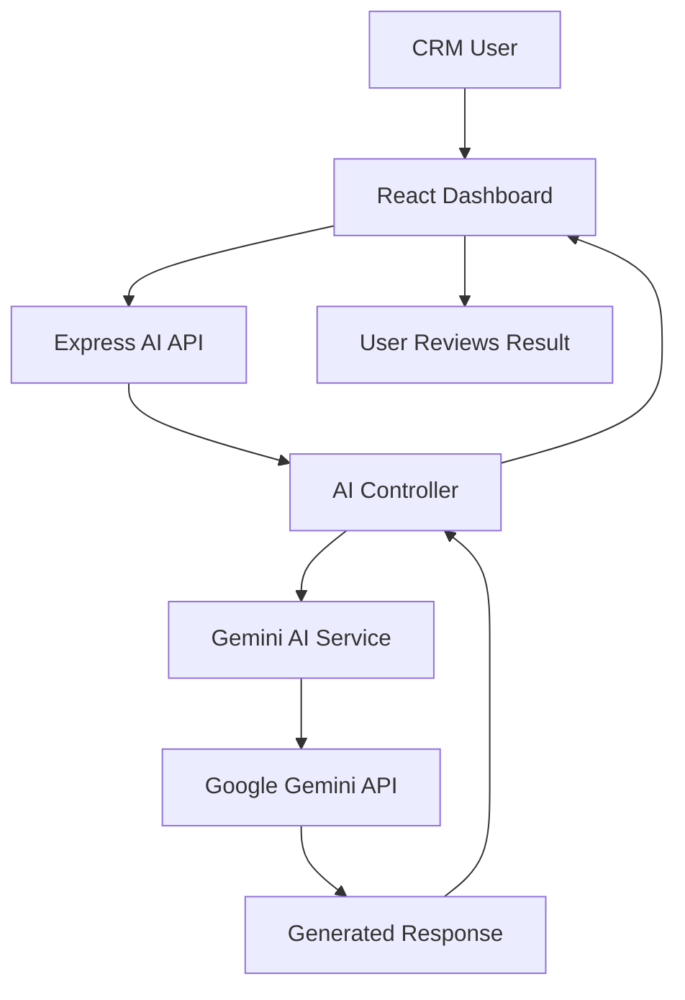
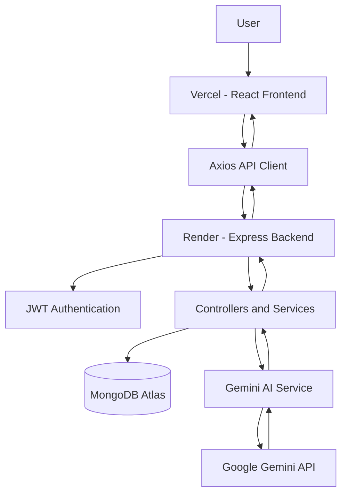

# 🟠 ClarioCRM
### Intelligent CRM. Smarter Relationships. Better Decisions.

<p align="center">
  
</p>

<p align="center">
  <strong>A modern CRM platform powered by the MERN stack and Google Gemini AI.</strong>
</p>

<p align="center">
  <a href="YOUR_VERCEL_URL">🌐 Live Application</a> •
  <a href="https://github.com/chanu2005-wq/AI_CRM_DASHBOARD">📦 Repository</a> •
  <a href="#-features">✨ Features</a> •
  <a href="#-installation">⚙️ Installation</a>
</p>

<p align="center">
  
  
  
  
  
  
</p>

---

## 👀 Product Showcase

<p align="center">
  
</p>

<p align="center">
  <em>Product walkthrough — dashboard, CRM workflows and AI-powered features.</em>
</p>

<p align="center">
  
  
</p>

<p align="center">
  
  
</p>

> **Note:** Add your actual screenshots and product walkthrough GIF at the paths above. These are asset placeholders, not live application captures.

---

## 📑 Table of Contents

<details open>
<summary><strong>Explore ClarioCRM Documentation</strong></summary>

- [Overview](#-overview)
- [Features](#-features)
- [AI Capabilities](#-ai-powered-capabilities)
- [Technology Stack](#-technology-stack)
- [Architecture](#-system-architecture)
- [Project Structure](#-project-structure)
- [Installation](#-installation)
- [Environment Variables](#-environment-variables)
- [Demo Account](#-demo-account)
- [API Reference](#-api-reference)
- [Deployment](#-deployment)
- [Security](#-security)
- [GitHub Statistics](#-github-statistics)
- [Roadmap](#-future-roadmap)
- [Author](#-author)

</details>

---

## 🚀 Overview

**ClarioCRM** is an AI-powered Customer Relationship Management platform designed to simplify sales operations, manage customer relationships and improve business productivity.

Built using the MERN stack, ClarioCRM combines a modern dashboard experience with secure REST APIs, MongoDB data persistence and Google Gemini AI integration.

The platform provides a centralized workspace for managing leads, contacts, sales pipelines, tasks and notes while using AI to assist with customer communication and sales insights.

### 🎯 Project Goals

- Centralize customer and sales information.
- Simplify lead and contact management.
- Improve sales workflow visibility.
- Reduce repetitive communication tasks with AI.
- Provide actionable insights from CRM data.
- Deliver a responsive and intuitive dashboard.

---

## ✨ Features

<table>
<tr>
<td width="50%">

### 📊 Dashboard Analytics
Monitor CRM activity, sales performance and business metrics through an interactive dashboard.

</td>
<td width="50%">

### 🎯 Lead Management
Create, update, organize and track potential customers throughout the sales process.

</td>
</tr>
<tr>
<td width="50%">

### 👥 Contact Management
Maintain customer profiles, company details and relationship information.

</td>
<td width="50%">

### 📈 Sales Pipeline
Visualize opportunities and monitor their progress through sales stages.

</td>
</tr>
<tr>
<td width="50%">

### ✅ Task Management
Organize follow-ups, manage activities and track task completion.

</td>
<td width="50%">

### 📝 Notes Management
Store important customer information and business notes.

</td>
</tr>
<tr>
<td width="50%">

### 🔐 Authentication
JWT-based authentication and protected API access.

</td>
<td width="50%">

### 🎨 Modern UI
Consistent visual design, reusable components and responsive layouts.

</td>
</tr>
</table>

---

## 🤖 AI-Powered Capabilities

ClarioCRM integrates Google Gemini AI to assist with CRM workflows.

| AI Feature | Functionality |
|---|---|
| 🧠 AI Lead Summary | Generate concise summaries from lead information. |
| ✉️ AI Email Generation | Create contextual email drafts for customer communication. |
| 📊 AI Sales Insights | Generate insights from available sales information. |

### AI Workflow



AI-generated content should be reviewed before use in customer communications or important business decisions.

---

## 🛠️ Technology Stack

<p align="center">
  
</p>

| Layer | Technologies |
|---|---|
| Frontend | React.js, Vite, JavaScript |
| UI | CSS, Tailwind CSS where implemented |
| API Communication | Axios, REST APIs |
| Backend | Node.js, Express.js |
| Database | MongoDB Atlas, Mongoose |
| Authentication | JSON Web Tokens |
| AI Integration | Google Gemini API |
| Version Control | Git, GitHub |
| Frontend Hosting | Vercel |
| Backend Hosting | Render |

---

## 🏗️ System Architecture

<p align="center">
  
</p>



### Application Flow

1. Users interact with the React frontend.
2. Axios sends requests to the Express REST API.
3. Authentication middleware validates protected requests.
4. Controllers process business logic.
5. Mongoose communicates with MongoDB Atlas.
6. AI services communicate with Google Gemini through the backend.
7. Responses are returned to the frontend.

---

## 📂 Project Structure

```text
AI_CRM_DASHBOARD/
│
├── client/
│   ├── public/
│   ├── src/
│   │   ├── components/
│   │   │   ├── ai/
│   │   │   ├── common/
│   │   │   ├── dashboard/
│   │   │   ├── layout/
│   │   │   └── ui/
│   │   ├── lib/
│   │   ├── pages/
│   │   └── ...
│   └── package.json
│
├── server/
│   ├── config/
│   ├── controllers/
│   ├── middleware/
│   ├── models/
│   ├── routes/
│   ├── services/
│   ├── utils/
│   ├── seed.js
│   ├── server.js
│   └── package.json
│
├── docs/
│   ├── assets/
│   │   └── clariocrm-demo.gif
│   └── screenshots/
│       ├── dashboard.png
│       ├── leads.png
│       ├── contacts.png
│       └── ai-features.png
│
├── .gitignore
└── README.md
```

---

## ⚙️ Installation

### Prerequisites

- Node.js and npm
- MongoDB Atlas account or local MongoDB
- Google Gemini API key
- Git

### 1. Clone the repository

```bash
git clone https://github.com/chanu2005-wq/AI_CRM_DASHBOARD.git

cd AI_CRM_DASHBOARD
```

### 2. Backend Setup

```bash
cd server
npm install
```

Create `server/.env`:

```env
PORT=5001
NODE_ENV=development

MONGODB_URL=your_mongodb_connection_string

JWT_SECRET=your_secure_jwt_secret
JWT_EXPIRES_IN=7d

FRONTEND_URL=http://localhost:5173

GEMINI_API_KEY=your_gemini_api_key
GEMINI_MODEL=your_supported_gemini_model
```

Start the backend:

```bash
npm run dev
```

### 3. Frontend Setup

Open another terminal:

```bash
cd client
npm install
```

Create `client/.env`:

```env
VITE_API_URL=http://localhost:5001/api
```

Start the frontend:

```bash
npm run dev
```

Open:

```text
http://localhost:5173
```

---

## 🔑 Environment Variables

### Backend

| Variable | Description |
|---|---|
| `PORT` | Backend server port |
| `NODE_ENV` | Application environment |
| `MONGODB_URL` | MongoDB connection string |
| `JWT_SECRET` | JWT signing secret |
| `JWT_EXPIRES_IN` | Token expiration |
| `FRONTEND_URL` | Allowed frontend origin |
| `GEMINI_API_KEY` | Google Gemini API key |
| `GEMINI_MODEL` | Supported Gemini model identifier |

### Frontend

| Variable | Description |
|---|---|
| `VITE_API_URL` | Backend API base URL |

**Security:** Never expose Gemini API keys, JWT secrets or MongoDB credentials in frontend code or public repositories.

---

## 👤 Demo Account

A seeded demo account is available for application demonstrations, provided the demo data has been initialized in the database.

| Credential | Value |
|---|---|
| Email | `Demo@example.com` |
| Password | `demo123` |

Use this account only for demonstration. Do not reuse the demo password for a real account.

---

## 🔌 API Reference

| Module | Base Route | Purpose |
|---|---|---|
| Authentication | `/api/auth` | Registration and login |
| Leads | `/api/leads` | Lead management |
| Contacts | `/api/contacts` | Contact management |
| Tasks | `/api/tasks` | Task management |
| Notes | `/api/notes` | Notes management |
| Analytics | `/api/analytics` | Dashboard analytics |
| AI | `/api/ai` | Gemini-powered functionality |

### AI Endpoints

| HTTP Method | Endpoint | Description |
|---|---|---|
| POST | `/api/ai/lead-summary` | Generate lead summaries |
| POST | `/api/ai/generate-email` | Generate email drafts |
| POST | `/api/ai/sales-insights` | Generate sales insights |

Protected endpoints require valid authentication where configured.

---

## ☁️ Deployment

ClarioCRM is deployed using the following architecture:

<p align="center">
  
  
  
</p>

| Component | Platform |
|---|---|
| Frontend | Vercel |
| Backend | Render |
| Database | MongoDB Atlas |
| AI Provider | Google Gemini |

### Production Environment

Frontend:

```env
VITE_API_URL=https://YOUR_RENDER_BACKEND_URL/api
```

Backend:

```env
NODE_ENV=production
MONGODB_URL=your_production_database_url
JWT_SECRET=your_production_secret
JWT_EXPIRES_IN=7d
FRONTEND_URL=https://YOUR_VERCEL_FRONTEND_URL
GEMINI_API_KEY=your_gemini_api_key
GEMINI_MODEL=your_supported_gemini_model
```

Configure CORS to allow the exact deployed frontend origin.

---

## 🔐 Security & Reliability

- JWT authentication and protected backend routes.
- Server-side Gemini API integration.
- Environment-based configuration.
- User ownership checks for CRM data.
- Separation of frontend and backend responsibilities.
- Secure handling of database and API credentials.

---

## 📈 GitHub Statistics

<p align="center">
  
  
</p>

<p align="center">
  
</p>

<p align="center">
  
</p>

<p align="center">
  
  
  
  
</p>

---

## 🛣️ Future Roadmap

Potential future enhancements:

- [ ] AI-powered lead scoring.
- [ ] Advanced sales forecasting.
- [ ] Automated follow-up reminders.
- [ ] Email service integration.
- [ ] Advanced reporting and exports.
- [ ] Role-based team management.
- [ ] Real-time CRM notifications.

---

## 👨‍💻 Author

<p align="center">
  <strong>Chanukya Chandra</strong>
  <br/>
  Full Stack Developer | AI & Machine Learning Enthusiast
  <br/><br/>
  <a href="https://github.com/chanu2005-wq">
    
  </a>
</p>

---

<p align="center">
  
  <br/>
  <strong>Intelligent CRM. Smarter Relationships. Better Decisions.</strong>
</p>
