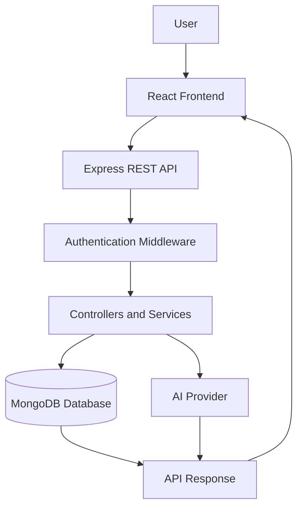

 
<h1 align="center">
  Welcome to ClarioCRM
  
</h1>

<div align="center">
  
</div>

<div align="center">
  
</div>

<p align="center">
  <a href="https://ai-crm-dashboard-blond.vercel.app/">
    
  </a>
  <a href="https://github.com/chanu2005-wq/AI_CRM_DASHBOARD">
    
  </a>
  
  
</p>

<p align="center">
  <strong>Smarter CRM. Stronger Business.</strong>
  <br/>
  A modern AI-powered Customer Relationship Management platform for managing leads, organizing contacts, and improving business productivity.
</p>

---

## 📌 Table of Contents

- [About ClarioCRM](#-about-clariocrm)
- [Features](#-features)
- [Application Preview](#-application-preview)
- [Architecture](#-architecture)
- [Technology Stack](#-technology-stack)
- [Project Structure](#-project-structure)
- [Getting Started](#-getting-started)
- [Environment Variables](#-environment-variables)
- [API Overview](#-api-overview)
- [Demo Account](#-demo-account)
- [Deployment](#-deployment)
- [Future Enhancements](#-future-enhancements)
- [Developer](#-developer)

---

## 🚀 About ClarioCRM

**ClarioCRM** is a full-stack Customer Relationship Management application built to simplify customer management and streamline sales workflows.

It provides a centralized workspace where users can manage leads, maintain contact records, monitor business activities, and use AI-powered tools to support everyday CRM operations.

### Why ClarioCRM?

- 📊 Centralized dashboard for CRM activities.
- 🎯 Organized lead and sales opportunity management.
- 👥 Efficient customer contact management.
- 🤖 AI-assisted summaries, email generation, and sales insights.
- 🔐 Authentication and protected application access.
- 🎨 Modern, responsive user interface.

---

## ✨ Features

<table>
<tr>
<td width="50%">
<h3>📊 Dashboard</h3>
<ul>
<li>CRM activity overview</li>
<li>Business performance metrics</li>
<li>Visual data representation</li>
</ul>
</td>
<td width="50%">
<h3>🎯 Lead Management</h3>
<ul>
<li>Organize potential customers</li>
<li>Track lead progress</li>
<li>Manage sales opportunities</li>
</ul>
</td>
</tr>
<tr>
<td width="50%">
<h3>👥 Contact Management</h3>
<ul>
<li>Maintain customer records</li>
<li>Access contact information</li>
<li>Organize customer details</li>
</ul>
</td>
<td width="50%">
<h3>🤖 AI Assistant</h3>
<ul>
<li>AI-assisted lead summaries</li>
<li>AI-generated email content</li>
<li>Sales insights</li>
</ul>
</td>
</tr>
</table>

---

## 🖥️ Application Preview

<p align="center">
  <strong>Dashboard</strong>
  <br/>
  
</p>

<p align="center">
  <strong>Lead Management</strong>
  <br/>
  
</p>

<p align="center">
  <strong>Contact Management</strong>
  <br/>
  
</p>

---

## 🏗️ Architecture

<p align="center">

[](https://gitdiagram.com/chanu2005-wq/ai_crm_dashboard?utm_source=readme&utm_medium=badge)

</p>

<p align="center">
  <em>Explore the repository architecture using GitDiagram.</em>
</p>

### Application Workflow



### Architecture Components

| Layer | Responsibility |
|---|---|
| React | User interface and dashboard |
| Express.js | REST API and request handling |
| Node.js | Backend runtime |
| MongoDB | Application data storage |
| Mongoose | Database models and queries |
| AI Provider | AI-assisted CRM functionality |

---

## 🛠️ Technology Stack

### Frontend

<p>
  
</p>

### Backend

<p>
  
</p>

### AI Integration

<p>
  <a href="https://ai.google.dev/">
    
  </a>
</p>

### Development and Deployment

<p>
  
</p>

---

## 📁 Project Structure

```text
AI_CRM_DASHBOARD/
│
├── client/
│   ├── public/
│   ├── src/
│   │   ├── assets/
│   │   ├── components/
│   │   ├── pages/
│   │   ├── services/
│   │   ├── hooks/
│   │   └── context/
│   ├── package.json
│   └── vite.config.js
│
├── server/
│   ├── config/
│   ├── controllers/
│   ├── middleware/
│   ├── models/
│   ├── routes/
│   ├── services/
│   ├── server.js
│   └── package.json
│
└── README.md
```

*The structure is representative; verify folder names against the actual repository.*

---

## ⚙️ Getting Started

### Prerequisites

- Node.js
- npm
- MongoDB Atlas or local MongoDB
- Git

### 1. Clone the repository

```bash
git clone https://github.com/chanu2005-wq/AI_CRM_DASHBOARD.git
cd AI_CRM_DASHBOARD
```

### 2. Install frontend dependencies

```bash
cd client
npm install
```

### 3. Install backend dependencies

```bash
cd ../server
npm install
```

### 4. Configure environment variables

Create `.env` files in the frontend and backend directories.

### 5. Start the backend

```bash
cd server
npm run dev
```

### 6. Start the frontend

Open another terminal:

```bash
cd client
npm run dev
```

Open the local URL provided by Vite.

---

## 🔑 Environment Variables

### Backend — `server/.env`

```env
PORT=5001
MONGODB_URL=your_mongodb_connection_string
JWT_SECRET=your_jwt_secret
JWT_EXPIRES_IN=your_token_expiry
FRONTEND_URL=http://localhost:5173

GEMINI_API_KEY=your_gemini_api_key
GEMINI_MODEL=your_gemini_model
```

### Frontend — `client/.env`

```env
VITE_API_URL=http://localhost:5001/api
```

**Security:**
- Never commit `.env` files.
- Keep database credentials and AI API keys on the backend.
- Never expose private API keys through frontend variables.
- Configure production environment variables separately.

*Use the exact variable names and port values defined by your application.*

---

## 🔌 API Overview

The backend provides REST API functionality for CRM operations.

### AI Endpoints

| Method | Endpoint | Description |
|---|---|---|
| POST | `/api/ai/lead-summary` | AI-assisted lead summary |
| POST | `/api/ai/generate-email` | AI-generated email content |
| POST | `/api/ai/sales-insights` | AI-assisted sales insights |

*Verify these paths against your actual Express route definitions before treating this table as the complete API reference.*

---

## 🔐 Demo Account

Explore ClarioCRM using the demo account, if demo authentication is enabled.

| Credential | Value |
|---|---|
| Email | `Demo@example.com` |
| Password | `demo123` |

Use demo credentials only for demonstration. Do not enter real customer information or sensitive data.

---

## 🌐 Deployment

ClarioCRM uses a separated frontend and backend deployment architecture.

| Component | Platform |
|---|---|
| Frontend | Vercel |
| Backend | Render |
| Database | MongoDB Atlas |

### Live Application

<p align="center">
  <a href="https://ai-crm-dashboard-blond.vercel.app/">
    
  </a>
</p>

---

## 🔮 Future Enhancements

- Advanced sales analytics.
- Automated customer follow-ups.
- AI-powered lead scoring.
- Email and calendar integrations.
- Role-based access control.
- Real-time notifications.
- Exportable business reports.

---

## 👨‍💻 Developer

<h2 align="center">CHANUKYA CHANDRA</h2>

<p align="center">
  Full Stack Developer | AI/ML Enthusiast
  <br/>
  Building modern web applications with MERN Stack and AI technologies.
</p>

<p align="center">
  <a href="https://github.com/chanu2005-wq">
    
  </a>
  <a href="https://github.com/chanu2005-wq/AI_CRM_DASHBOARD">
    
  </a>
</p>

---

<h3 align="center">⭐ Explore ClarioCRM and experience smarter customer management!</h3>

<p align="center">
  <strong>ClarioCRM — Smarter CRM. Stronger Business.</strong>
</p>
