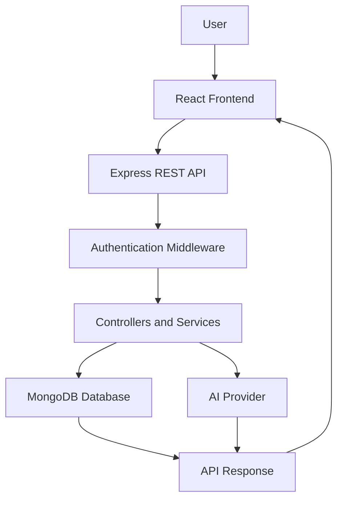

 
<h1 align="center">
  Welcome to <span>ClarioCRM</span>
  
</h1>

<div align="center">
  
</div>

<div align="center">
  
</div>

<p align="center">
  <a href="https://ai-crm-dashboard-blond.vercel.app/">
    
  </a>
  <a href="https://github.com/chanu2005-wq/AI_CRM_DASHBOARD">
    
  </a>
  
  
  
</p>

---

## 🚀 About ClarioCRM


**ClarioCRM** is a modern, AI-powered Customer Relationship Management platform designed to simplify customer management, organize sales activities, and improve business productivity.

It brings essential CRM functionality into one centralized dashboard, helping users manage leads, maintain customer information, monitor business activities, and access AI-assisted insights.

### ✨ What makes ClarioCRM useful?

- 📊 **Dashboard:** Get an overview of CRM activities and business performance.
- 🎯 **Lead Management:** Organize potential customers and track sales opportunities.
- 👥 **Contact Management:** Maintain and manage customer information.
- 🤖 **AI Assistance:** Generate lead summaries, email content, and sales insights.
- 🔐 **Authentication:** Secure access to CRM functionality.
- 🎨 **Modern UI:** Clean, responsive, and intuitive dashboard experience.

<br clear="right"/>

---

## 🌟 Key Features

<table>
  <tr>
    <td width="50%">
      <h3>📊 Dashboard Analytics</h3>
      <p>Centralized dashboard for viewing important CRM information and business activity.</p>
    </td>
    <td width="50%">
      <h3>🎯 Lead Management</h3>
      <p>Organize leads, maintain their information, and manage sales opportunities.</p>
    </td>
  </tr>
  <tr>
    <td width="50%">
      <h3>👥 Contact Management</h3>
      <p>Keep customer records organized and accessible from one place.</p>
    </td>
    <td width="50%">
      <h3>🤖 AI-Powered Tools</h3>
      <p>Use AI-assisted summaries, email generation, and sales insights.</p>
    </td>
  </tr>
  <tr>
    <td width="50%">
      <h3>🔐 Authentication</h3>
      <p>Authentication and protected application access.</p>
    </td>
    <td width="50%">
      <h3>📱 Responsive Interface</h3>
      <p>A modern interface designed for convenient CRM navigation.</p>
    </td>
  </tr>
</table>

---

## 🖥️ Application Preview

<p align="center">
  <strong>Dashboard</strong>
  <br/>
  
</p>

<p align="center">
  <strong>Lead Management</strong>
  <br/>
  
</p>

<p align="center">
  <strong>Contact Management</strong>
  <br/>
  
</p>

---

## 🛠️ Languages and Technologies

<p align="center">
  <a href="https://react.dev/" title="React">
    
  </a>
  <a href="https://vite.dev/" title="Vite">
    
  </a>
  <a href="https://tailwindcss.com/" title="Tailwind CSS">
    
  </a>
  <a href="https://nodejs.org/" title="Node.js">
    
  </a>
  <a href="https://expressjs.com/" title="Express.js">
    
  </a>
  <a href="https://www.mongodb.com/" title="MongoDB">
    
  </a>
  <a href="https://developer.mozilla.org/en-US/docs/Web/JavaScript" title="JavaScript">
    
  </a>
  <a href="https://git-scm.com/" title="Git">
    
  </a>
  <a href="https://github.com/" title="GitHub">
    
  </a>
  <a href="https://postman.com/" title="Postman">
    
  </a>
</p>

### AI Integration

<p align="center">
  <a href="https://ai.google.dev/" title="Google Gemini">
    
  </a>
  <a href="https://openai.com/" title="OpenAI">
    
  </a>
</p>

---

## 🏗️ System Architecture

<p align="center">
  
</p>

### Application Workflow



---

## 📁 Project Structure

```text
AI_CRM_DASHBOARD/
│
├── client/
│   ├── public/
│   ├── src/
│   │   ├── assets/
│   │   ├── components/
│   │   ├── pages/
│   │   ├── services/
│   │   ├── hooks/
│   │   └── context/
│   └── package.json
│
├── server/
│   ├── config/
│   ├── controllers/
│   ├── middleware/
│   ├── models/
│   ├── routes/
│   ├── services/
│   ├── server.js
│   └── package.json
│
└── README.md
```

*This is a representative structure; update it if your actual repository layout differs.*

---

## ⚙️ Installation and Setup

### Prerequisites

- Node.js
- npm
- MongoDB Atlas or local MongoDB
- Git

### 1. Clone the repository

```bash
git clone https://github.com/chanu2005-wq/AI_CRM_DASHBOARD.git
cd AI_CRM_DASHBOARD
```

### 2. Install frontend dependencies

```bash
cd client
npm install
```

### 3. Install backend dependencies

```bash
cd ../server
npm install
```

### 4. Configure environment variables

Create the backend `.env` file:

```env
PORT=5001
MONGODB_URL=your_mongodb_connection_string
JWT_SECRET=your_jwt_secret
JWT_EXPIRES_IN=your_token_expiry
FRONTEND_URL=http://localhost:5173
GEMINI_API_KEY=your_gemini_api_key
GEMINI_MODEL=your_gemini_model
```

Create the frontend `.env` file:

```env
VITE_API_URL=http://localhost:5001/api
```

Use the exact variable names and port configured in your application. Never commit actual secrets.

### 5. Run the backend

```bash
cd server
npm run dev
```

### 6. Run the frontend

Open another terminal:

```bash
cd client
npm run dev
```

Open the local URL provided by Vite.

---

## 🌐 Live Deployment

<p align="center">
  <a href="https://ai-crm-dashboard-blond.vercel.app/">
    
  </a>
</p>

| Layer | Platform |
|---|---|
| Frontend | Vercel |
| Backend | Render |
| Database | MongoDB Atlas |

---

## 🔮 Future Enhancements

- Advanced CRM analytics and reporting.
- Automated customer follow-up reminders.
- AI-based lead scoring.
- Email and calendar integrations.
- Role-based access control.
- Real-time notifications.
- Exportable CRM reports.

---

## 👨‍💻 Developed By

<h2 align="center">CHANUKYA CHANDRA</h2>

<p align="center">
  <strong>Full Stack Developer | AI/ML Enthusiast</strong>
  <br/>
  Building practical applications with modern web technologies and AI.
</p>

<p align="center">
  <a href="https://github.com/chanu2005-wq">
    
  </a>
  <a href="https://github.com/chanu2005-wq/AI_CRM_DASHBOARD">
    
  </a>
</p>

---

<h3 align="center">⭐ If you find ClarioCRM interesting, explore the live application!</h3>

<p align="center">
  <strong>ClarioCRM — Smarter Customer Management. Better Business Relationships.</strong>
</p>
