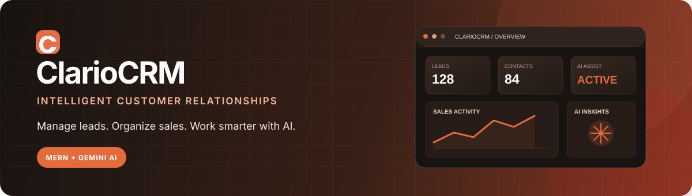
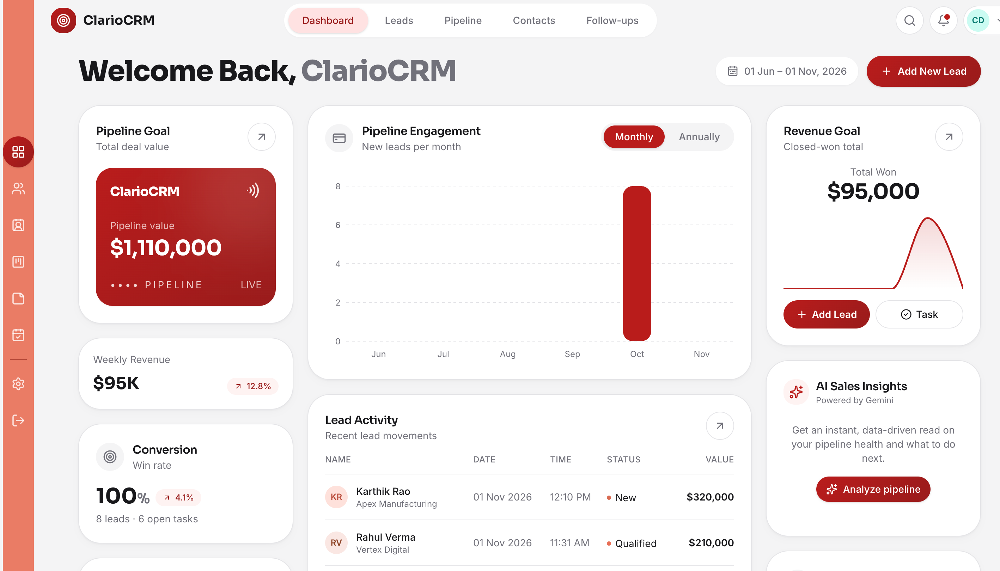
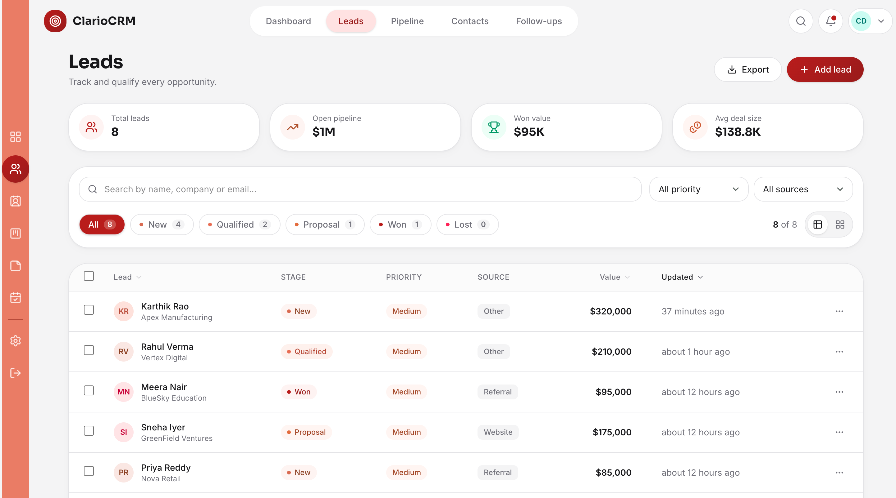
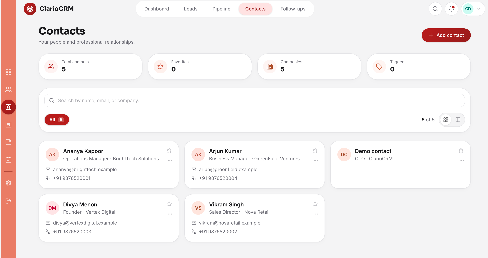

 
# ClarioCRM — AI-Powered Customer Relationship Management

<p align="center">
  
</p>

<p align="center">
  <a href="https://ai-crm-dashboard-blond.vercel.app/">
    
  </a>
  <a href="https://github.com/chanu2005-wq/AI_CRM_DASHBOARD">
    
  </a>
  
  
</p>

<p align="center">
  <strong>Manage relationships. Track opportunities. Make smarter decisions.</strong>
  <br />
  ClarioCRM is a modern, AI-powered CRM dashboard designed to simplify customer management, streamline sales workflows, and provide actionable business insights through an intuitive interface.
</p>

---

## Table of Contents

- [Overview](#overview)
- [Features](#features)
- [Application Preview](#application-preview)
- [Technology Stack](#technology-stack)
- [System Architecture](#system-architecture)
- [Project Structure](#project-structure)
- [Getting Started](#getting-started)
- [Environment Variables](#environment-variables)
- [API Overview](#api-overview)
- [Demo Account](#demo-account)
- [Deployment](#deployment)
- [Future Improvements](#future-improvements)
- [Contributing](#contributing)
- [License](#license)

## Overview

**ClarioCRM** is a full-stack Customer Relationship Management application built to help businesses organize customer information, manage leads, monitor sales activities, and improve productivity.

The application combines a clean dashboard experience with AI-powered capabilities to reduce repetitive tasks and support data-driven decision-making.

### Why ClarioCRM?

- **Centralized Management** — Organize leads, contacts, and customer information in one place.
- **Sales Visibility** — Monitor sales activities and track business performance.
- **AI Assistance** — Use AI-powered functionality to support CRM workflows.
- **Modern Interface** — Navigate through a responsive and intuitive dashboard.
- **Scalable Architecture** — Built with the MERN stack for maintainability and extensibility.

## Features

### Dashboard

- Centralized overview of CRM activities.
- Key business metrics and performance summaries.
- Visual representation of relevant business data.
- Quick access to important CRM modules.

### Lead Management

- Organize and manage potential customers.
- Track lead information and progress.
- Support sales pipeline management.
- Keep lead-related information accessible.

### Contact Management

- Maintain customer contact information.
- Organize customer records.
- Access relevant customer details efficiently.

### AI-Powered Capabilities

- AI-assisted lead summaries.
- AI-generated email content.
- Sales insights and business analysis.

### Authentication and User Interface

- User authentication.
- Protected dashboard access.
- Consistent navigation and reusable UI components.
- Responsive dashboard experience.

## Application Preview

The following images are intended to showcase the actual ClarioCRM interface. Replace the paths with screenshots from the application where necessary.

| Dashboard | Leads |
|---|---|
|  |  |

| Contacts | AI Features |
|---|---|
|  |  |

## Technology Stack

| Category | Technologies |
|---|---|
| Frontend | React.js, JavaScript, Vite |
| Styling | Tailwind CSS, CSS |
| Backend | Node.js, Express.js |
| Database | MongoDB, Mongoose |
| Authentication | JWT-based authentication, if configured |
| AI Integration | Google Gemini, if configured |
| API Communication | REST APIs |
| Deployment | Vercel, Render |
| Version Control | Git, GitHub |

## System Architecture

ClarioCRM follows a client-server architecture using the MERN stack.

<p align="center">
  
</p>

### Application Flow

1. The user interacts with the React frontend.
2. The frontend sends HTTP requests to the Express API.
3. Express routes requests to the appropriate controllers and services.
4. The backend validates requests and performs business operations.
5. Mongoose communicates with MongoDB to store and retrieve CRM data.
6. AI-related requests are processed through the backend using the configured AI provider.
7. The API returns responses to the frontend for display.

## Project Structure

```text
AI_CRM_DASHBOARD/
│
├── client/
│   ├── public/
│   ├── src/
│   │   ├── assets/
│   │   ├── components/
│   │   ├── pages/
│   │   ├── services/
│   │   ├── hooks/
│   │   ├── context/
│   │   ├── App.jsx
│   │   └── main.jsx
│   ├── package.json
│   └── vite.config.js
│
├── server/
│   ├── config/
│   ├── controllers/
│   ├── middleware/
│   ├── models/
│   ├── routes/
│   ├── services/
│   ├── server.js
│   └── package.json
│
├── .gitignore
└── README.md
```

*The structure above is illustrative. Adjust it to match the actual folders and files in the repository.*

## Getting Started

Follow these steps to run ClarioCRM locally.

### Prerequisites

Make sure you have installed:

- Node.js (LTS recommended)
- npm
- MongoDB Atlas account or local MongoDB instance
- Git

### 1. Clone the Repository

```bash
git clone https://github.com/chanu2005-wq/AI_CRM_DASHBOARD.git
cd AI_CRM_DASHBOARD
```

### 2. Install Frontend Dependencies

```bash
cd client
npm install
```

### 3. Install Backend Dependencies

Open another terminal:

```bash
cd server
npm install
```

### 4. Configure Environment Variables

Create `.env` files in the `client` and `server` directories.

Refer to the environment variable section below.

### 5. Start the Backend

```bash
cd server
npm run dev
```

### 6. Start the Frontend

In another terminal:

```bash
cd client
npm run dev
```

Open the local URL printed by Vite in your browser.

## Environment Variables

### Backend — `server/.env`

```env
PORT=5001
MONGODB_URL=your_mongodb_connection_string
JWT_SECRET=your_secure_jwt_secret
JWT_EXPIRES_IN=your_token_expiry
FRONTEND_URL=http://localhost:5173

GEMINI_API_KEY=your_gemini_api_key
GEMINI_MODEL=your_configured_gemini_model
```

### Frontend — `client/.env`

```env
VITE_API_URL=http://localhost:5001/api
```

**Security Notes**

- Never commit `.env` files to GitHub.
- Keep database credentials, JWT secrets, and AI API keys on the backend.
- Never expose private API keys through frontend environment variables.
- Configure production environment variables separately in your deployment platforms.
- Use `.env.example` files to document required configuration without including secrets.

*Environment variable names and port values must match the actual application configuration.*

## API Overview

The backend exposes REST API endpoints for CRM operations.

### AI Endpoints

| Method | Endpoint | Purpose |
|---|---|---|
| POST | `/api/ai/lead-summary` | Generate an AI-assisted lead summary |
| POST | `/api/ai/generate-email` | Generate email content |
| POST | `/api/ai/sales-insights` | Generate sales-related insights |

These routes are based on the project's previously documented API functionality. Verify the actual route definitions before relying on them.

### Authentication and CRM APIs

Authentication, lead, contact, and dashboard endpoints depend on the routes implemented in the backend.

Refer to the server route files for the complete and current API contract.

## Demo Account

You can explore the deployed application using the demo account if demo authentication is enabled.

| Field | Value |
|---|---|
| Email | `Demo@example.com` |
| Password | `demo123` |

**Note:** This is a public demonstration account. Do not use real customer information or sensitive data with demo credentials. Keep demo access isolated from administrative accounts.

## Deployment

ClarioCRM uses separate frontend and backend deployments.

| Component | Platform |
|---|---|
| Frontend | Vercel |
| Backend | Render |
| Database | MongoDB Atlas |

### Frontend Deployment

1. Import the GitHub repository into Vercel.
2. Set the root directory to `client`.
3. Configure the production build command:

   ```bash
   npm run build
   ```

4. Set the output directory to `dist`.
5. Configure `VITE_API_URL` with the deployed backend API URL.

### Backend Deployment

1. Create a Render Web Service.
2. Set the root directory to `server`.
3. Configure the build command:

   ```bash
   npm install
   ```

4. Configure the start command:

   ```bash
   npm start
   ```

5. Add the backend environment variables in Render.
6. Configure MongoDB Atlas network access and database credentials.
7. Set `FRONTEND_URL` to the deployed frontend origin.

### Live Application

<p align="center">
  <a href="https://ai-crm-dashboard-blond.vercel.app/">
    <strong>Open ClarioCRM Live Demo →</strong>
  </a>
</p>

## Future Improvements

Potential enhancements for future releases:

- Advanced sales analytics and reporting.
- Role-based access control.
- Automated follow-up reminders.
- Email and calendar integrations.
- Advanced lead scoring.
- AI-powered customer recommendations.
- Exportable reports and dashboards.
- Real-time notifications.

## Contributing

Contributions, suggestions, and bug reports are welcome.

1. Fork the repository.
2. Create a feature branch:

   ```bash
   git checkout -b feature/your-feature-name
   ```

3. Commit your changes:

   ```bash
   git commit -m "feat: add your feature"
   ```

4. Push your branch:

   ```bash
   git push origin feature/your-feature-name
   ```

5. Open a Pull Request.

## License

This project is available under the license specified in the repository.

---

<p align="center">
  <strong>ClarioCRM</strong>
  <br />
  Smarter Customer Management. Better Business Relationships.
  <br /><br />
  Built with the MERN Stack.
</p>
