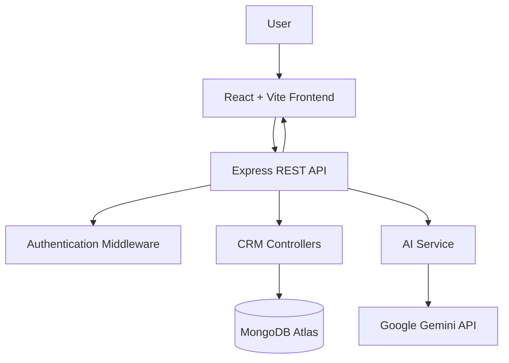

# ClarioCRM

<div align="center">


### Customer relationships. Organized. Intelligent. Connected.

A modern CRM dashboard built with the MERN stack, designed to help manage customers, leads, contacts, and sales activities with AI-powered assistance.

<br/>

[](https://ai-crm-dashboard-blond.vercel.app/)
[](https://github.com/chanu2005-wq/AI_CRM_DASHBOARD)

<br/>


</div>

---

## Preview

<div align="center">


<sub>Dashboard preview — replace this filename with the matching image from client/src/assets/.</sub>

</div>

## About

ClarioCRM is a full-stack customer relationship management application built to bring customer and sales management into one interface. It combines a React-based dashboard with a Node.js and Express backend, MongoDB data storage, and AI-powered productivity features.

The application is designed around a clean dashboard experience, a focused CRM workflow, and a warm red-orange visual identity.

## Features

| Area | Capabilities |
|---|---|
| Dashboard | Overview of CRM activity and key information |
| Lead Management | Organize and manage sales leads |
| Contact Management | Maintain customer and contact information |
| Authentication | User authentication and protected application access |
| AI Lead Summary | Generate AI-assisted lead summaries |
| AI Email Generation | Generate email content with AI assistance |
| Sales Insights | Get AI-assisted sales insights |

<div align="center">


<sub>Lead management interface</sub>

<br/><br/>


<sub>Contact management interface</sub>

<br/><br/>


<sub>AI-powered CRM features</sub>

</div>

## AI Integration

ClarioCRM integrates Google Gemini for AI-assisted CRM workflows.

- **Lead Summary:** Creates a concise summary of lead information.
- **Email Generation:** Helps generate professional email content.
- **Sales Insights:** Provides AI-assisted analysis of sales information.

AI requests are handled by the backend so that provider credentials remain server-side.

## Technology Stack

| Layer | Technologies |
|---|---|
| Frontend | React.js, Vite, JavaScript |
| Backend | Node.js, Express.js |
| Database | MongoDB, Mongoose |
| AI | Google Gemini API |
| Authentication | JWT-based authentication |
| Deployment | Vercel, Render |
| Database Hosting | MongoDB Atlas |

## Architecture



## Project Structure

```text
AI_CRM_DASHBOARD/
│
├── client/
│   ├── public/
│   ├── src/
│   │   ├── assets/
│   │   ├── components/
│   │   ├── pages/
│   │   ├── services/
│   │   ├── context/
│   │   └── ...
│   ├── package.json
│   └── vite.config.js
│
├── server/
│   ├── config/
│   ├── controllers/
│   ├── middleware/
│   ├── models/
│   ├── routes/
│   ├── services/
│   ├── server.js
│   └── package.json
│
├── .gitignore
└── README.md
```

<sub>Illustrative structure; confirm directory names against the current repository.</sub>

## Getting Started

### Prerequisites

- Node.js and npm
- MongoDB Atlas account or a local MongoDB instance
- Google Gemini API key

### 1. Clone the repository

```bash
git clone https://github.com/chanu2005-wq/AI_CRM_DASHBOARD.git
cd AI_CRM_DASHBOARD
```

### 2. Configure the backend

```bash
cd server
npm install
```

Create a `.env` file in the server directory and configure the variables expected by the backend:

```env
PORT=5001
MONGODB_URL=your_mongodb_connection_string
JWT_SECRET=your_jwt_secret
JWT_EXPIRES_IN=your_jwt_expiry
FRONTEND_URL=http://localhost:5173

GEMINI_API_KEY=your_gemini_api_key
GEMINI_MODEL=your_supported_gemini_model
```

Start the backend:

```bash
npm run dev
```

### 3. Configure the frontend

Open a second terminal:

```bash
cd client
npm install
```

Create the frontend environment file:

```env
VITE_API_URL=http://localhost:5001/api
```

Start the frontend:

```bash
npm run dev
```

Open the local URL displayed by Vite.

> **Security:** Never commit `.env` files or expose Gemini API keys, JWT secrets, or database credentials in frontend code.

## API Overview

The AI functionality includes the following backend endpoints:

| Method | Endpoint | Purpose |
|---|---|---|
| POST | `/api/ai/lead-summary` | Generate a lead summary |
| POST | `/api/ai/generate-email` | Generate email content |
| POST | `/api/ai/sales-insights` | Generate sales insights |

Other authentication and CRM endpoints are available in the backend routes. Refer to the source code for their exact paths, request bodies, and authorization requirements.

## Demo Access

A demonstration account is available in the application, if enabled in the deployed environment.

Do not use production administrator credentials in this public README. Demo credentials should only be published if the account is intentionally configured for public access and contains non-sensitive sample data.

## Live Deployment

<div align="center">

[](https://ai-crm-dashboard-blond.vercel.app/)

</div>

| Resource | Link |
|---|---|
| Live Application | [Open ClarioCRM](https://ai-crm-dashboard-blond.vercel.app/) |
| GitHub Repository | [AI_CRM_DASHBOARD](https://github.com/chanu2005-wq/AI_CRM_DASHBOARD) |
| Frontend Hosting | Vercel |
| Backend Hosting | Render |
| Database | MongoDB Atlas |

## Future Improvements

- Advanced CRM analytics and reporting
- More detailed sales pipeline visualization
- Role-based access control
- Activity reminders and notifications
- Additional AI-assisted workflows

## Author

**Chanukya Chandra**

Full Stack Developer | MERN Stack | AI Integration

<div align="center">

[GitHub](https://github.com/chanu2005-wq)

<br/>

**Built with React, Node.js, MongoDB, and AI.**

</div>
